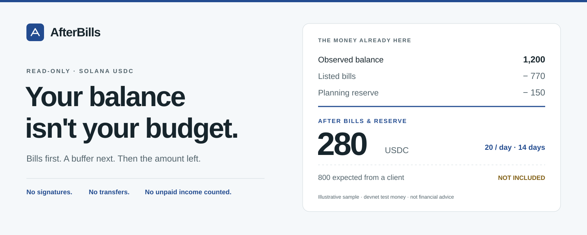
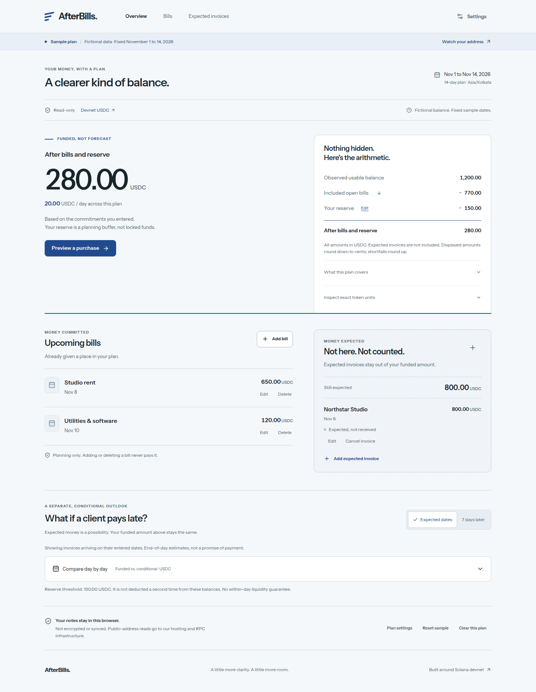
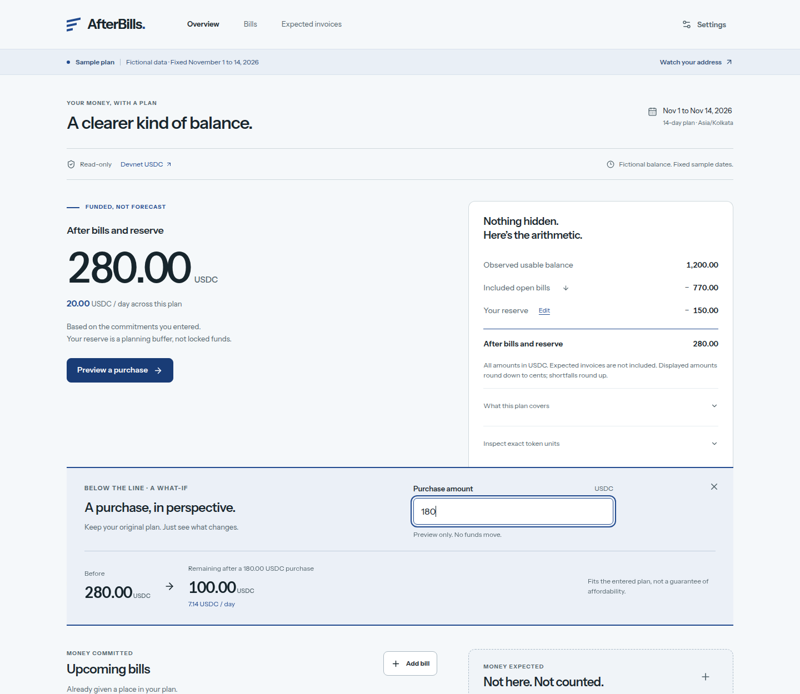
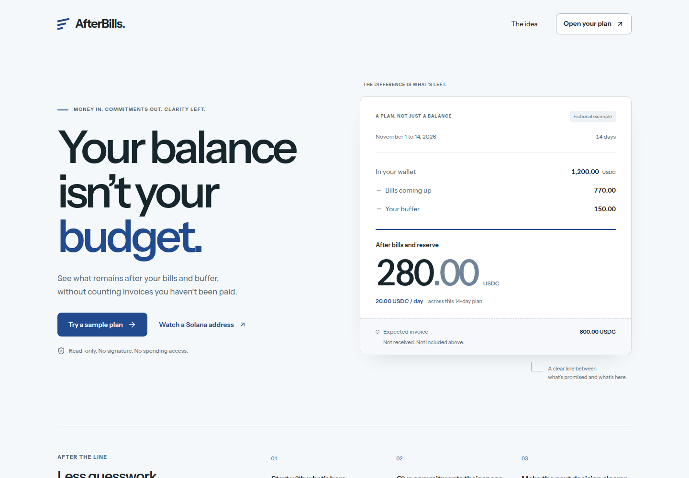
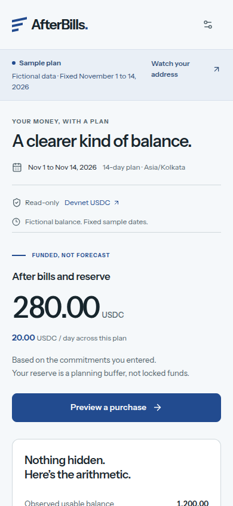
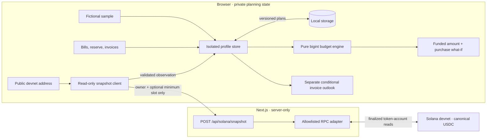

# AfterBills



**A cash-flow planner for freelancers paid in Solana USDC.**
See what remains after bills and a buffer, without counting money you haven't received.

[Screenshots](#product-tour) · [Quick start](#quick-start) · [Architecture](#architecture) · [Validation](docs/VALIDATION.md) · [Submission details](docs/SUBMISSION.md)

> **Devnet prototype. Read-only. Browser-local.**
> No wallet connection, private keys, signatures, or transfers.
> Devnet tokens have no monetary value. This is a planning tool, not financial advice.

**[Open live demo →](https://afterbills-seven.vercel.app)** · **[Try the sample plan →](https://afterbills-seven.vercel.app/app?mode=sample)** · **[Watch the 1-minute explainer →](https://github.com/puri-adityakumar/afterbills/blob/main/docs/AfterBills-explainer.mp4)** · **[Presentation →](https://github.com/puri-adityakumar/afterbills/blob/main/docs/AfterBills-presentation.pptx)**
**Code:** [github.com/puri-adityakumar/afterbills](https://github.com/puri-adityakumar/afterbills).

## Why AfterBills?

A wallet can tell you that you have 1,200 USDC. It cannot tell you that 770 is
already needed for bills, that you want to keep a 150 buffer, or that an unpaid
client invoice might arrive late.

AfterBills puts a clear line between **money already here** and **money only
expected**. The main result is backed by visible arithmetic, not a forecast.

```text
Observed usable balance                  1,200 USDC
− Included open bills                      770 USDC
− Planning reserve                         150 USDC
──────────────────────────────────────────────────
After bills and reserve                    280 USDC
Daily planning pace over 14 days             20 USDC

Expected client invoice                    800 USDC  → not included above
```

These are fictional sample figures. A reserve is a planning deduction, not locked funds.

## Product tour

### A funded answer, with its proof



### Try a purchase before changing anything

Previewing a 180 USDC purchase leaves 100 USDC, or a rounded-down 7.14 per day.
The original plan remains visible. No money moves and no expense is saved.



<details>
<summary>Landing page and mobile layout</summary>





</details>

All product screenshots are real local production-build captures using the
fictional sample, taken on November 1, 2026. They are not live wallet balances.

## What you can do

| Feature | What it means |
|---|---|
| Start without a wallet | Explore a clearly labeled sample with no account or setup. |
| Watch a public devnet address | Read finalized canonical USDC balances, with source slot and observation time. |
| Plan your commitments | Add, edit, and remove dated bills; set a reserve and timezone. |
| Keep invoices separate | Record expected income without inflating the funded amount. |
| Preview a purchase | Compare the original plan with one hypothetical purchase. |
| Model a late payment | Shift expected invoices by seven days in a separate conditional outlook. |
| Inspect the calculation | Review included bills, assumptions, and exact token base units. |
| Keep notes in your browser | Isolated sample/live profiles, local persistence, explicit clearing, and storage warnings. |

Shortfalls are shown explicitly. Failed balance reads are **unknown or stale,
never silently zero**. Frozen balances are excluded from usable funds; detected
token delegation produces a warning.

## Quick start

### Prerequisites

- **Node.js 24** and **npm 11** are the tested versions.
- No wallet, API key, Solana CLI, SOL, or funded account is required.

```sh
git clone https://github.com/puri-adityakumar/afterbills.git
cd afterbills
npm ci
npm run dev
```

Open [127.0.0.1:3000](http://127.0.0.1:3000), then choose **Try a sample plan**.
Or go directly to [/app?mode=sample](http://127.0.0.1:3000/app?mode=sample).
To try live reads, use **Watch a Solana address** and enter a public devnet
address, never a private key or seed phrase.

For a local production preview:

```sh
npm run build
npm run start
```

Local servers bind to loopback. Stop an existing server before rebuilding.

### Environment

The default public Solana devnet endpoint works without configuration.
To use your own provider, copy `.env.example` to `.env.local` and set values privately.

| Variable | Default | Purpose |
|---|---|---|
| `SOLANA_RPC_URL` | `https://api.devnet.solana.com` | Server-only RPC endpoint. |
| `AFTERBILLS_NETWORK` | `devnet` | The only supported network; other values fail closed. |

Do not prefix an RPC credential with `NEXT_PUBLIC_` or commit `.env.local`.
The API fixes the network, canonical USDC mint, and six decimals server-side.
It does not accept arbitrary RPC URLs or token mints.

## Architecture

One Next.js application. Local planning and chain observation are separate.
There is no database, custom Solana program, or money-moving endpoint.



**Financial labels never enter the snapshot request.** Public-address queries do
reach hosting and RPC infrastructure. Local storage is not encrypted or synced.

### Financial invariants

- `fundedNet = usableBalance − includedOpenBills − reserve`.
- Unpaid invoices affect only conditional forecasts, never `fundedNet`.
- A purchase preview subtracts from the funded result without mutating the plan.
- Amounts use integer base units and `bigint`, not floating-point accounting.
- Positive display values round down; shortfalls round up to avoid hiding tiny deficits.
- Plans cover 14 calendar dates in the selected timezone, including overdue open bills.
- Live windows roll forward with the date. The labeled sample retains fixed dates.
- A manually marked received invoice never credits an observed balance again.

### Stack and layout

**Next.js 16 · React 19 · TypeScript 6 · Solana RPC · plain CSS**

Exact dependency versions are pinned in `package.json` and `package-lock.json`.
Instrument Sans is self-hosted. Tests use Vitest, Testing Library, Playwright, and axe.

```text
src/
├── app/                  Routes, metadata, and snapshot API
├── contracts/            Shared types and application boundaries
├── domain/               Exact money, dates, budgets, and forecasts
├── features/             Dashboard, forms, and purchase preview
├── server/solana/        Validated read-only RPC adapter
├── state/                Profiles, persistence, and observation freshness
├── fixtures/             Explicitly fictional sample
└── styles/               Responsive layouts and reduced-motion rules
tests/
├── domain/               Financial invariants and date boundaries
├── solana/               Adapter and route validation
├── planning/             Persistence, isolation, and user actions
├── ui/                   Rendering and callbacks
├── e2e/                  Desktop/mobile browser flows
└── integration/          Opt-in real devnet read
```

## Validation

Recorded local and hosted results, October 31–November 1, 2026:

| Check | Result |
|---|---|
| Unit and component tests | **285 passed**, rerun November 1; one opt-in network test skipped by default |
| Browser tests | **18 passed** across desktop/mobile Chromium on October 31; hosted sample/purchase/mobile smoke checks passed November 1 |
| Lint / TypeScript / production build | **Passed**; direct Vercel production build also passed |
| Real devnet integration | **Passed separately**, including local and publicly hosted API-route reads |
| Automated accessibility | No axe violations on the sampled pages and settings dialog |
| Production dependency audit | **Zero vulnerabilities**, rechecked November 1; development lint tooling has 16 moderate advisories |

```sh
npm test
npm run lint
npm run typecheck
npm run build
npm run test:e2e
```

If needed, install Chromium with `npx playwright install chromium` before e2e.
Build first; the browser suite starts its own production server.
Ordinary tests do not require network access. To opt into a real devnet read:

```sh
RUN_LIVE_RPC=1 npm test -- tests/integration/live-read.test.ts
```

[Validation evidence and limitations →](docs/VALIDATION.md)
Mocked tests and screenshots are not presented as blockchain settlement evidence.
Mobile checks use Chromium viewports, not physical devices or Safari.

## Trust boundaries and current limits

- **Devnet only.** Test tokens, one watched address, one supported mint, a 14-day plan.
- **Read-only.** No custody, signatures, transfers, wallet connection, automatic payments,
  or verification of invoice receipts. An address lookup does not prove ownership.
- **Manual inputs.** Results cover only the bills and assumptions you enter, not your
  entire financial life. They do not guarantee affordability or payment arrival.
- **Browser-local data.** Notes are not encrypted, authenticated, backed up, or synced.
  Use fictional financial labels when exploring or sharing the prototype.
- **Bounded RPC.** Request validation, timeouts, same-origin checks, no-store responses,
  and best-effort in-process limiting are implemented. The Vercel project also has
  a scoped snapshot-API rate limit of 30 requests per IP per 60 seconds, counted per
  region. These controls are not a guarantee against every form of abuse.
- **Public prototype.** Hosted on Vercel by direct CLI upload, not a GitHub-linked
  automatic deployment. Search indexing remains disabled. Broader CSP hardening,
  financial-data security review, and operational monitoring are future release work.

## Deployment

The public devnet app is at **https://afterbills-seven.vercel.app**.
It was deployed directly with Vercel CLI, without requiring a Vercel–GitHub
repository connection. A GitHub push alone does **not** redeploy this app.

For a direct deployment to your own Vercel project, use an authenticated CLI:

```sh
vercel link
vercel deploy --prod
```

The existing AfterBills project uses the Next.js preset, `npm ci`, and
`npm run build`. The public devnet RPC works without a provider secret.
`.vercelignore` excludes environment files, local data, caches, tests, and
documentation from the source upload. Keep `.vercel/` and all local environment
files out of Git. Recreate the hosting-level API rate limit in any new project.

## Roadmap

- [x] Exact funded calculation and inspectable arithmetic
- [x] Dated bills, reserve, expected invoices, and local persistence
- [x] Purchase preview and separate seven-day payment-delay scenario
- [x] Real finalized devnet USDC reads and explicit stale/error states
- [x] Desktop/mobile tests, keyboard dialogs, and reduced-motion support
- [x] Verified public Vercel deployment
- [x] One-minute explainer video and a presentation (see [docs](docs/))
- [ ] Freelancer interviews and usability validation
- [ ] Verified incoming receipts and user-confirmed reconciliation
- [ ] Export/import and additional planning horizons

Unchecked items are planned, not working features.

## Project documentation

| Document | Contents |
|---|---|
| [Submission details](docs/SUBMISSION.md) | Paste-ready checkpoint description and honest link status |
| [Product requirements](docs/PRD.md) | Audience, scope, financial rules, and acceptance examples |
| [Technical specification](docs/TECHNICAL_SPEC.md) | Contracts, architecture, storage, and Solana reads |
| [Design direction](DESIGN.md) | “After the line” concept, typography, and interaction principles |
| [UI specification](docs/UI_SPEC.md) | Layouts, forms, responsive behavior, and error states |
| [Validation](docs/VALIDATION.md) | Actual test results, devnet evidence, and release gates |
| [Research](research/RESEARCH.md) | Source register and product assumptions |
| [Explainer video](docs/AfterBills-explainer.mp4) | One-minute walkthrough with Microsoft neural voiceover |
| [Presentation](docs/AfterBills-presentation.pptx) | Ten-slide PowerPoint with speaker notes |
| [Checkpoint](docs/CHECKPOINT.md) | Submission checklist and video/deck notes |

Built for the **Best Consumer App on Solana** track.
